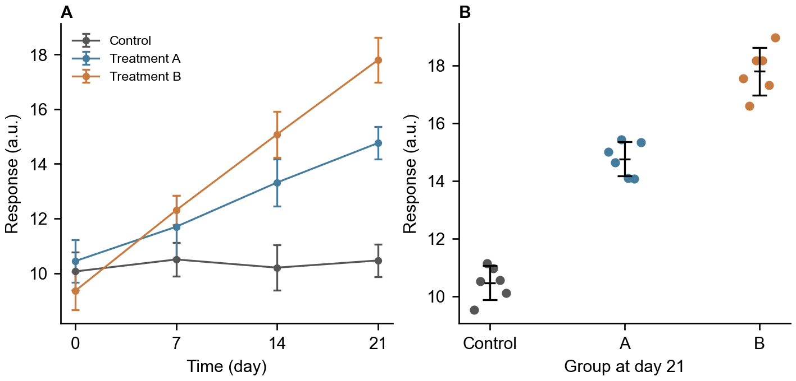

# 研究问题与数据

本稿件使用专用合成数据验证中文、公式、图表和引用的导出。正文编辑标记。实验包含三个分组和四个测量时间，每个组合具有六个独立样本，共 72 行。

| 分组 | 时间 day | 每时点样本量 |
| --- | --- | --- |
| 对照组 | 0、7、14、21 | 6 |
| 处理 A | 0、7、14、21 | 6 |
| 处理 B | 0、7、14、21 | 6 |

# 方法与可编辑公式

样本均值记为 $\bar{x}$，采用以下公式计算：

$$\bar{x}=\frac{1}{n}\sum_{i=1}^{n}x_i$$

该公式需在 Word 中保留为原生公式对象。方法资料来自专用测试条目 [@phase0source]。

# 结果图与图注

{width=13cm}

图 1 用于验证科研图、图注与正文之间的完整导出；本合成数据不代表真实研究结果。

# 参考文献
