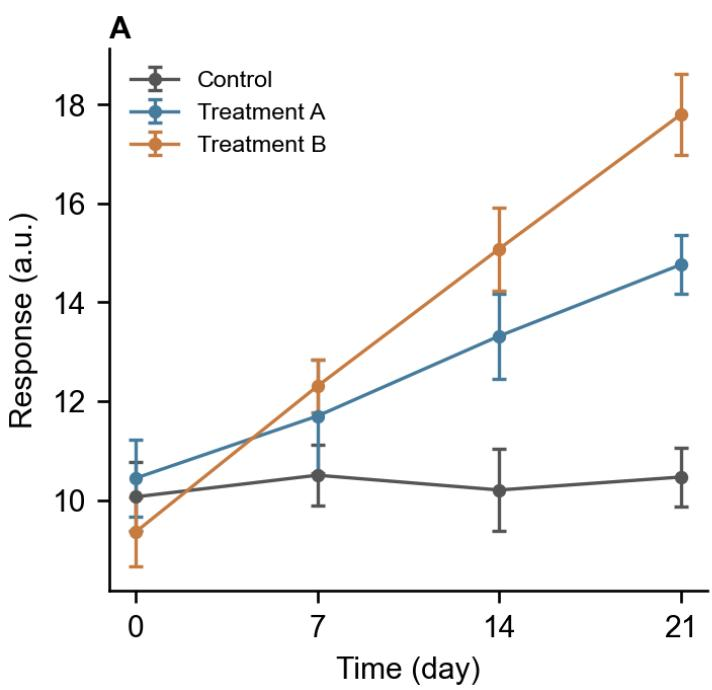
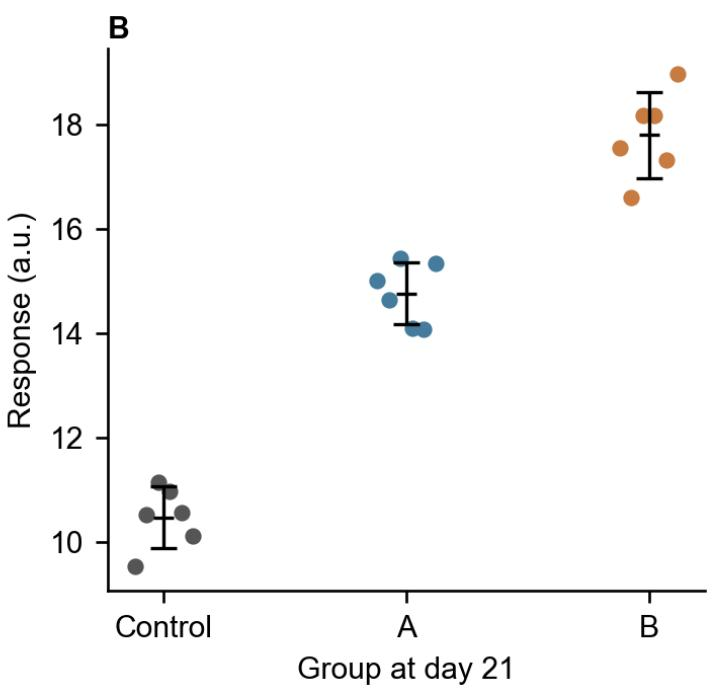

PHASE0-PAGE-ONE | Synthetic experiment, 2026

Three groups; four time points; six independent samples per cell. Response measurements are synthetic and use arbitrary units.

Table 1. Experimental design

<table><tr><td>Group</td><td>Days</td><td>n per day</td></tr><tr><td>Control</td><td>0, 7, 14, 21</td><td>6</td></tr><tr><td>Treatment A</td><td>0, 7, 14, 21</td><td>6</td></tr><tr><td>Treatment B</td><td>0, 7, 14, 21</td><td>6</td></tr></table>

  
Figure 1. Synthetic response over time and distribution at day 21.

  
Points and error bars show descriptive values; error bars denote SD.

## Methods and provenance

PHASE0-PAGE-TWO | Mean response calculation

The sample mean is computed from n independent observations:

$$
\bar {x} = \frac {1}{n} \sum_ {i = 1} ^ {n} x _ {i}
$$

The seed and data version are retained for reproducibility.

中文定位标记：正文证据需要关联原文页码或段落位置。

## References

[1] Phase Zero Team. Synthetic Fixture for Capability Tests. 2026.

This is a generated test reference, not a published paper.